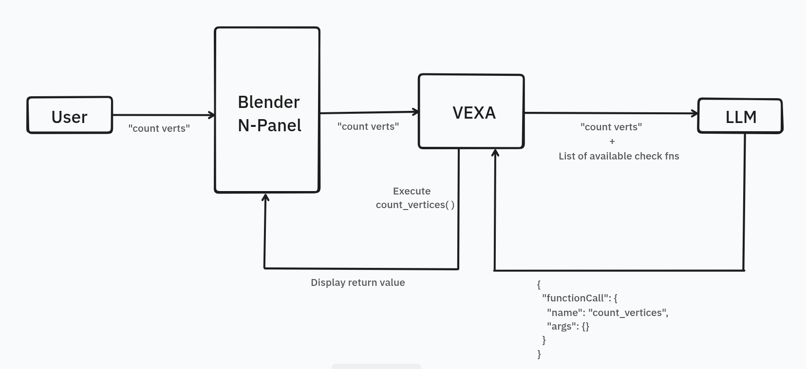

# Vexa

Technical documentation for developers.

## Architecture

Vexa has three execution paths, all built on one registry of tools (`core/registry.py`).

### Inference Path
1. Select object(s) and type a prompt in Blender's N-Panel
2. Prompt + available functions sent to LLM as JSON schema
3. LLM returns structured function call
4. Vexa executes the function in Blender
5. Result displayed in panel

 

### Direct Path
1. User clicks action button
2. Vexa executes the function in Blender
3. Result displayed in panel

### Preset Path
1. User picks a target (a preset, e.g. "Unreal project") and clicks Check Assets
2. `core/runner.py` runs every check in the preset with the preset's settings
3. Results are listed in the panel, with select-problems and one-click fixes

All three paths use the same underlying tools from the registry.

## Layout

```
vexa/
  core/
    registry.py     AgentTools: tools, checks and fixes, plus Gemini schemas
    results.py      Issue and CheckResult: what every check returns
    scope.py        which meshes a check looks at (selection, or the runner's scope)
    presets.py      loads preset .json files
    runner.py       runs checks and fixes; reports
    selection.py    selects the objects and faces a check flagged
    props.py        scene and window-manager properties for the panel
  tools/            every tool, check and fix, one module per area
  presets/          built-in targets: general, unity_asset_store, fab, unreal
  operators/        quick actions, the AI prompt, and the check panel's operators
  ui/panel.py       the sidebar
```

## Kinds of tool

| Kind | Register with | Returns | Example |
| --- | --- | --- | --- |
| Tool | `AgentTools.register` | a message string | `select_hard_edges` |
| Check | `AgentTools.register_check` | a list of `Issue` | `detect_ngons` |
| Fix | `AgentTools.register_fix` | a message string | `triangulate_ngons` |

Checks and fixes are tools too: each gets a Gemini schema and can be a quick action.
Called that way, a check runs on the selected meshes, selects what it found and
returns a summary; a fix finds its check's issues on the selection and fixes them.

## Implemented Tools

| Area | Module | Checks | Fixes |
| --- | --- | --- | --- |
| General | `general_tools.py` | – | Count vertices, Rename object, Select hard edges (tools) |
| Geometry | `geometry_tools.py` | N-gons, Non-planar faces, Intersecting meshes, Triangle budget | Triangulate n-gons, Triangulate non-planar faces |
| Transforms | `transform_tools.py` | Transforms applied, Negative scale, Pivot at bottom centre, Scene unit scale | Apply transforms, Move pivot, Set unit scale |
| UVs | `uv_tools.py` | UV map present, Lightmap UV channel | – |
| Texture | `texture_tools.py` | Missing textures, Texture colour space, Texture sizes, Empty material slots | Fix colour spaces, Remove unused slots |
| Naming | `naming_tools.py` | Default object names, Allowed name characters, Asset name prefix | Fix invalid names, Add name prefix |
| Collision | `collision_tools.py` | Collision meshes (UCX_) | – |
| Rigging | `rigging_tools.py` | Bone influences per vertex | – |

## Adding New Tools

```python
from ..core.registry import AgentTools

@AgentTools.register(
    display_name="My Tool",
    is_quick_action=True,
    category="Geometry",
)
def my_tool() -> str:
    """Description shown to LLM."""
    return "Result message"
```

## Adding a Check

A check reads its meshes from `current()`, takes its settings as keyword arguments
with defaults, and returns issues. Presets override settings by name, and the
schema exposes them to the LLM.

```python
from ..core.registry import AgentTools
from ..core.results import Issue
from ..core.scope import current

@AgentTools.register_check(
    display_name="My check",
    category="Geometry",
    why="One sentence an artist understands: what breaks in engine if this is wrong.",
    severity="WARNING",
)
def my_check(limit: int = 10) -> list:
    """Description shown to LLM."""
    return [Issue(obj.name, "What's wrong", value="measured", target="expected")
            for obj in current().meshes if too_many(obj, limit)]

@AgentTools.register_fix("my_check", display_name="Fix It")   # optional, only if always safe
def fix_my_check(issues, limit: int = 10) -> str:
    ...
    return "Fixed N things"
```

Put it in the matching `tools/<area>_tools.py` (a new module also goes in
`MODULES` in `tools/__init__.py`), add it to a preset, and add a test in
`tests/test_<area>_tools.py`.

## Presets

A preset is a JSON file choosing checks, severities and settings:

```json
{
  "id": "acme",
  "name": "Acme Studio",
  "description": "Our outsourcing spec",
  "checks": {
    "detect_unapplied_transforms": {"severity": "ERROR"},
    "detect_over_triangle_budget": {"severity": "WARNING", "max_tris": 15000},
    "detect_missing_name_prefix": {"severity": "WARNING", "prefix": "SM_"}
  }
}
```

Built-in presets live in `vexa/presets/`. Teams can point **Preferences → Team
presets folder** at a shared folder of their own. An unknown setting name is
reported as an error rather than ignored.

## Tests

```bash
# with Blender
blender -b --factory-startup -P tests/run_all.py

# or with the bpy module (pip install bpy, matching Python version)
python tests/run_all.py
```

Each `tests/test_*.py` file also runs on its own. `run_all.py` exits non-zero on
failure, and CI runs it on every push (see `.github/workflows/ci.yml`).

## Releases

Push a tag like `v0.5.0` and `.github/workflows/release.yml` builds `vexa.zip` and
attaches it to a GitHub release. The website links to
`releases/latest/download/vexa.zip`, so it always serves the newest release.
